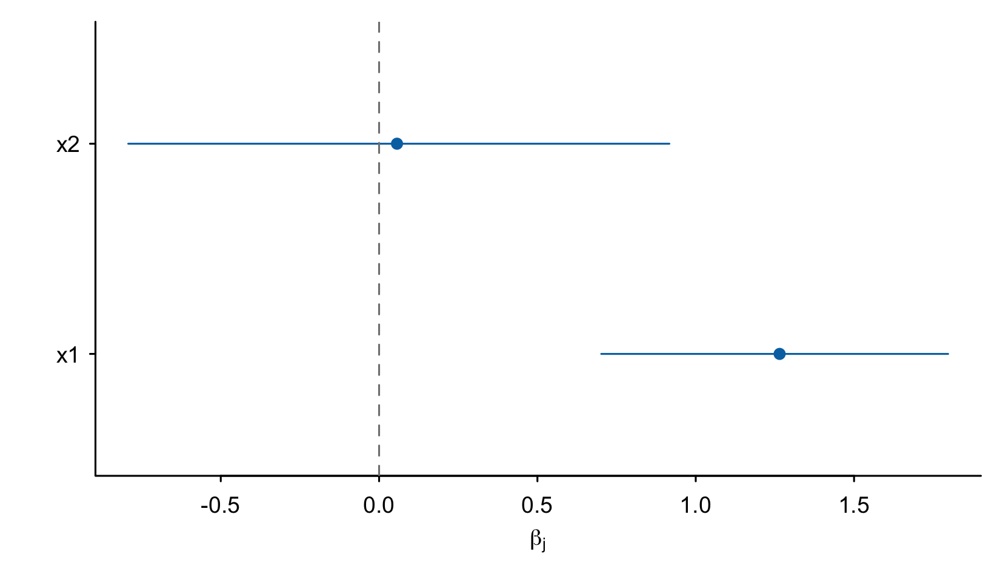

# VsusP

VsusP selects variables from Bayesian shrinkage-regression draws. Sequential
two-means (S2M), from Li and Pati (2017), estimates a signal count and selects
coefficients by their posterior median absolute magnitude. The package also
provides Gaussian fitting, posterior summaries, prediction and diagnostic plots.

[](https://github.com/nilson01/VsusP-variable-selection-using-shrinkage-priors/actions/workflows/R-CMD-check.yaml)
[](https://github.com/nilson01/VsusP-variable-selection-using-shrinkage-priors/actions/workflows/test-coverage.yaml)

## Installation

CRAN release:

```r
install.packages("VsusP")
```

The examples below use the GitHub version:

```r
install.packages("remotes") # Run once if needed.
remotes::install_github("nilson01/VsusP-variable-selection-using-shrinkage-priors")
library(VsusP)
```

## Select variables from posterior draws

Put draws in rows and coefficients in columns; exclude the intercept.

```r
Beta <- rbind(c(.01, .02, .03, .3, .31, 10, 11),
              c(-.01, -.02, -.03, -.3, -.31, -10, -11))
colnames(Beta) <- paste0("x", seq_len(ncol(Beta)))
set.seed(1)
path <- Sequential2MeansBeta(Beta, lower = .1, upper = .5, l = 2)
path$H.b.i
#> [1] 4 2
OptimalHbi(path$b.i, path$H.b.i)

selected <- S2MVarSelection(Beta, H = path$H.b.i[2])
colnames(Beta)[selected]
#> [1] "x7" "x6"
```

Here the second threshold is used for illustration. `OptimalHbi()` plots the
counts; it does not choose a threshold. Inspect sensitivity to the threshold,
predictor units and posterior sampling before interpreting a selection.

## Fit and predict

```r
X <- cbind(x1 = c(-2, -1, 0, 1, 2, 0), x2 = c(0, 1, -1, 0, 1, -1))
y <- c(-3, -1, 0, 1, 3, .5)
fit <- FitRidge(X, y, draws = 1000, chains = 2, seed = 8)
summary(fit)
predict(fit, X[1:2, , drop = FALSE])
PlotCoefficients(fit)
```



`predict()` gives pointwise intervals for the conditional mean. Set
`include.noise = TRUE` to obtain posterior predictive intervals for observations.
`PosteriorDraws(fit)` pools chains for selection; the fitted object retains
separate chains for diagnostics. See `?FitGaussian` for priors and centering.

## Methods

| Purpose | Functions |
|---|---|
| Fit Gaussian regression | `FitRidge()`, `FitHorseshoe()`, `FitSpikeSlab()` |
| Fit through `bayesreg` and apply S2M | `Sequential2Means()` |
| Summarize and predict | `summary()`, `coef()`, `predict()`, `PosteriorDraws()` |
| Check and plot chains | `ChainDiagnostics()`, `PlotTrace()`, `PlotAutocorrelation()` |
| Summarize exact-zero inclusions | `SpikeSlabSelection()`, `PlotInclusion()` |
| Compare selection thresholds | `S2MSensitivity()`, `plot()` |
| Apply basic two-means selection | `TwoMeansBeta()` |
| Construct a sparse predictor | `SAVS()`, `DSS()` |

`ChainDiagnostics()` requires the suggested `posterior` package. Native fits
center inputs without scaling them; their priors differ from `bayesreg` defaults.
Check chain diagnostics and sampling sensitivity for iterative fits. Short
examples do not establish convergence.

By default, S2M retains at least one signal. SAVS and penalized DSS can return an
empty selection. Clustering counts are not posterior inclusion probabilities;
use exact-zero spike-and-slab draws for inclusion summaries. These methods do
not provide automatic false-positive control. See the guide for boundary
conventions, scaling effects and DSS tuning.

## Documentation

- [Reference manual](VsusP.pdf): function inputs, outputs and figures.
- [Worked guide](vignettes/VsusPVignette.pdf): fitting, selection, prediction and checks.
- In R: `vignette("VsusPVignette")`.
- [Validation](inst/validation/README.md): exploratory pilot and reproducible results.
- [Development checks](tools/README.md): archive and platform verification.

## References

Li, H. and Pati, D. (2017). Variable selection using shrinkage priors.
*Computational Statistics & Data Analysis*, **107**, 107–119.
[doi:10.1016/j.csda.2016.10.008](https://doi.org/10.1016/j.csda.2016.10.008).

Ray, P. and Bhattacharya, A. (2018). *Signal Adaptive Variable Selector for the
Horseshoe Prior*. [arXiv:1810.09004](https://arxiv.org/abs/1810.09004).

Hahn, P. R. and Carvalho, C. M. (2015). Decoupling Shrinkage and Selection in
Bayesian Linear Models: A Posterior Summary Perspective.
*Journal of the American Statistical Association*, **110**(509), 435–448.
[doi:10.1080/01621459.2014.993077](https://doi.org/10.1080/01621459.2014.993077).
